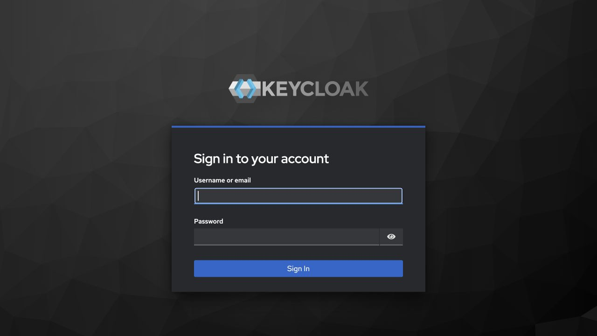
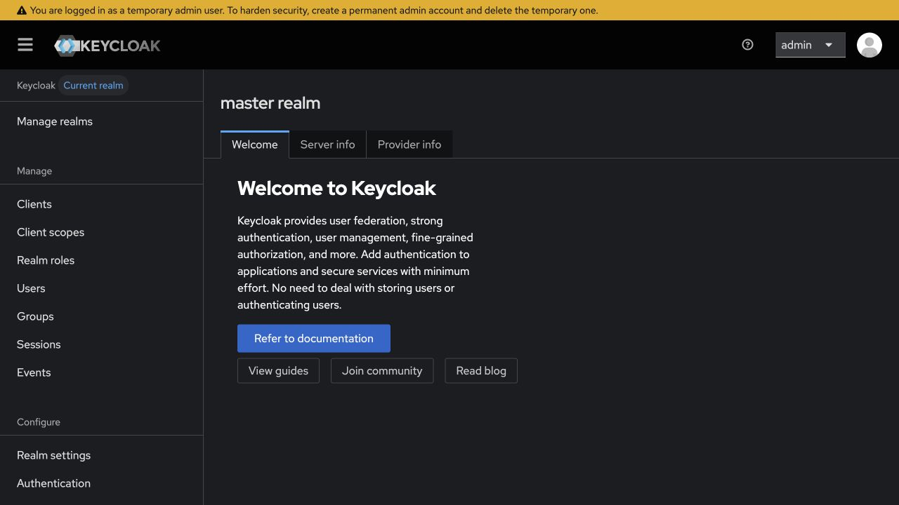
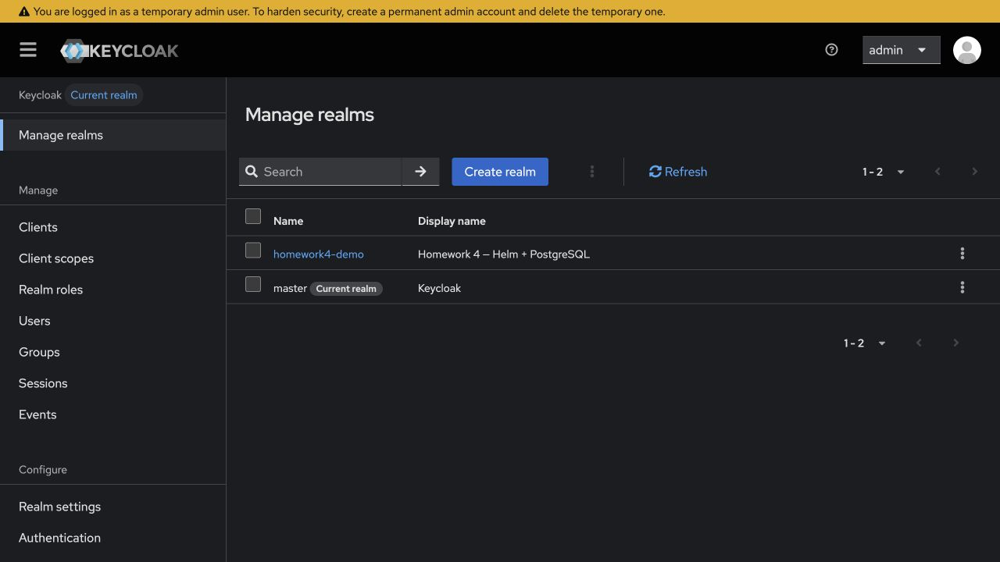
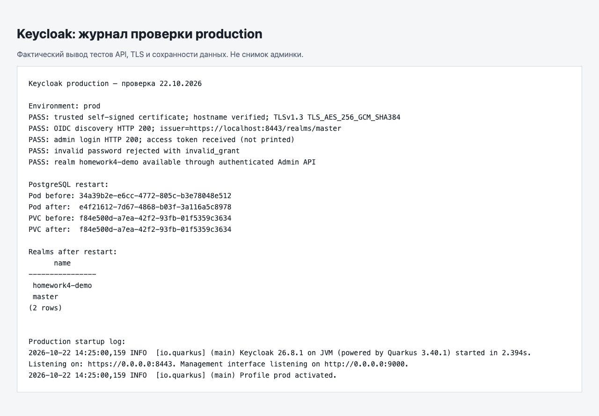

# Фотоотчёт: домашняя работа 4

Проверено 22 октября 2026 года в отдельном локальном кластере `homework-4`.
Среда: macOS arm64, Podman 6.0.2, kind 0.33.0, Kubernetes 1.37.0,
Helm 3.22.1, Keycloak 26.8.1, PostgreSQL 17.6.

## Задание и решение

Задание на слайде 34: собственный Helm-чарт с Keycloak, dev-режим (6),
production-режим (8), самоподписанный сертификат (10), фотоотчёт.
Сделан собственный чарт `keycloak/`, готовые сторонние чарты не использовались.
Назначение каждого ресурса и команды воспроизведения описаны в [README](README.md).

`main` объединён с `Vvil1568/ProductionServerAppDeployment:main` (коммит
`aabfe1d`). Ветка `homework-4` создана от результата слияния `7f6732f`.
Ранее выполненные домашние работы №2 и №3 сохранены.

## 1. Dev-режим

Установка: `./setup.sh dev`. Keycloak запускается командой `start-dev`.
В логе подтверждено `Profile dev activated`, приложение слушает HTTP 8080.

Страница входа на `http://localhost:8080/admin/`:



Успешный вход под `admin`:



Создан тестовый realm `homework4-demo`:



Жёлтое сообщение относится к bootstrap-администратору Keycloak: для постоянной
эксплуатации нужно создать постоянную учётную запись администратора.
В учебном стенде проверяется вход через bootstrap-учётную запись.

## 2. Production и HTTPS

Установка: `./setup.sh prod`. Используется команда `start`, PostgreSQL
и сертификат из Secret `keycloak-tls`. HTTP приложения выключен.
В логе подтверждены `Profile prod activated` и HTTPS на порту 8443.

Ресурсы после установки и проверок перезапуска:

```text
NAME                       READY   UP-TO-DATE   AVAILABLE   AGE
deployment.apps/keycloak   1/1     1            1           5m29s

NAME                                   READY   AGE
statefulset.apps/keycloak-postgresql   1/1     5m29s

NAME                            READY   STATUS      RESTARTS   AGE
pod/keycloak-6658ff8447-x6jh9   1/1     Running     0          47s
pod/keycloak-postgresql-0       1/1     Running     0          77s
pod/keycloak-test-oidc          0/1     Completed   0          3m4s

NAME                          TYPE        CLUSTER-IP      EXTERNAL-IP   PORT(S)    AGE
service/keycloak              ClusterIP   10.96.216.190   <none>        8443/TCP   5m29s
service/keycloak-postgresql   ClusterIP   None            <none>        5432/TCP   5m29s

NAME                                               STATUS   VOLUME                                     CAPACITY   ACCESS MODES   STORAGECLASS   VOLUMEATTRIBUTESCLASS   AGE
persistentvolumeclaim/data-keycloak-postgresql-0   Bound    pvc-f84e500d-a7ea-42f2-93fb-01f5359c3634   1Gi        RWO            standard       <unset>                 5m29s
```

Внешний доступ выполнен через `kubectl port-forward svc/keycloak 8443:8443`.
Проверка `curl --cacert` вернула HTTP 200. Дополнительно клиент Python
проверил цепочку доверия, имя `localhost`, TLS 1.3, выдачу токена администратору
и отказ при неверном пароле. Пароли и токены в отчёте отсутствуют.

Ниже снимок страницы, отображающей фактический журнал проверок production;
это **не снимок production-админки**. Исходный вывод: [verification.txt](report/verification.txt).
Встроенный браузер отказался открывать production с `ERR_CERT_AUTHORITY_INVALID`,
поскольку сертификат самоподписанный. Проверка клиентом с явно доверенным
сертификатом прошла; проверка сертификата не отключалась.



## 3. Helm-тесты и обновление

Для обоих values-файлов успешно выполнены `helm lint --strict`, `helm template`
и серверная валидация манифестов `kubectl apply --dry-run=server`.
Неверный mode, production без TLS и несоответствующая схема hostname
отклоняются при рендеринге чарта.

После повторного `./setup.sh prod` и `./setup.sh dev` оба релиза получили
ревизию 2, сохранив существующие Secrets. У каждого релиза Helm-тест
`keycloak-test-oidc` завершился с `Phase: Succeeded`. В prod тест обращается
к сервису по HTTPS и доверяет только переданному публичному сертификату.
Вывод теста:

```text
PASS: OIDC discovery contains the expected issuer; TLS verified when enabled.
```

## 4. Проверка сохранности данных

В production через Admin API создан realm `homework4-demo`. Затем выполнено:

```bash
kubectl -n keycloak-prod delete pod keycloak-postgresql-0
kubectl -n keycloak-prod rollout status statefulset/keycloak-postgresql --timeout=120s
kubectl -n keycloak-prod exec keycloak-postgresql-0 -- \
  psql -U keycloak -d keycloak -c 'SELECT name FROM realm ORDER BY name;'
```

UID Pod изменился, UID PVC остался прежним; SQL-результат до и после совпал:

```text
      name
----------------
 homework4-demo
 master
(2 rows)
```

Далее выполнен `kubectl rollout restart deployment/keycloak -n keycloak-prod`.
После готовности нового Pod восстановлен port-forward и повторена проверка
входа и чтения realm:

```text
Environment: prod
PASS: trusted self-signed certificate; hostname verified; TLSv1.3 TLS_AES_256_GCM_SHA384
PASS: OIDC discovery HTTP 200; issuer=https://localhost:8443/realms/master
PASS: admin login HTTP 200; access token received (not printed)
PASS: invalid password rejected with invalid_grant
PASS: realm homework4-demo available through authenticated Admin API
```

Таким образом, конфигурация Keycloak хранится в PostgreSQL на PVC и сохраняется
при пересоздании Pod приложения и базы. Это однорепличный учебный стенд:
в нём не реализованы HA и резервное копирование, а удаление kind-кластера
удаляет и его локальное хранилище.
